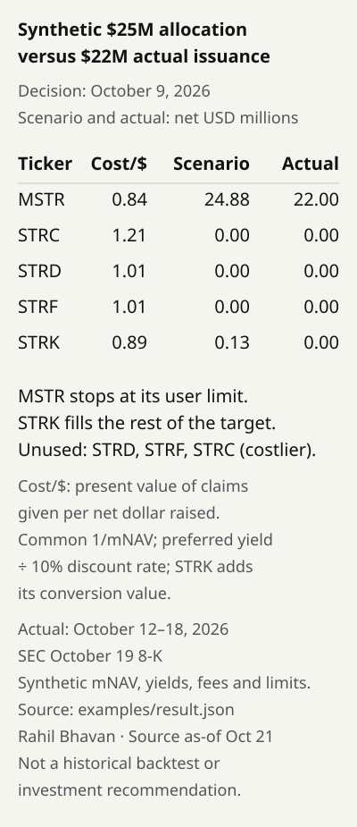

# Strategy issuance router: compare financing rules with weekly issuance

[](https://github.com/RahilBhavan/strategy-issuance-router/actions/workflows/ci.yml)



A deterministic Python CLI splits a net funding target across Strategy's (MSTR) common stock and USD preferreds under disclosed ATM capacity, instrument limits and an annual dividend budget. It ranks each instrument by the present value of claims handed to new holders per net dollar raised, and shows which constraint stops each one. It gives a recommendation for a future week, or compares a past week with actual issuance. The market inputs are **synthetic**; capacity and actual issuance come from a pinned, bundled subset of the public SEC-derived ledger.

## What it does

- Prices every instrument on one basis: common at `1/mNAV` of NAV claim per gross dollar; preferreds at annual yield capitalized at a stated perpetual discount rate (10% in the demo); STRK adds the Black–Scholes value of its conversion right. It reports cost per net dollar, the binding constraint, the discount rate at which each preferred would beat common, unfilled funding, missing inputs and capacity evidence.
- Warns when common is issued below mNAV 1, or excludes it with `"common_below_nav": "block"`.
- Requires a decision before the target period; later issuance amounts do not influence allocation. A week not yet in the ledger gives a forward-looking recommendation with no actual comparison.
- Replays an October 9, 2026 synthetic $25M target against October 12–18 actual issuance ([result](examples/result.json)). The router issues **$24.875M net of MSTR** (stopped by its $25M gross limit) and $0.125M of STRK; Strategy issued **$22M MSTR net proceeds** and no preferred ATM proceeds. The earlier one-year proxy issued only $3.11M of MSTR. The closer match follows from the synthetic inputs: above a 12% discount rate, STRF and STRD rank ahead of common.
- Runs offline with no sibling checkout, package dependencies, credentials or paid feed.

## How it works

`router/io.py` validates scenario JSON and the ledger CSV contract, then selects capacity known by the cutoff. `router/core.py` greedily ranks claim value per net dollar and records which bound (target, dividend budget, user limit or disclosed capacity) stops each instrument. `router/__main__.py` adds actual comparisons after allocation when the ledger has the target week, and rounds output to cents for display. [Method](docs/method.md) explains why perpetual dividends are capitalized, how to choose the discount rate, the STRK conversion term and the precision policy.

## Run it

Python 3.11+; locally tested with 3.14.7; CI pins 3.14.0. No installation step or network access is needed after cloning.

```bash
git clone https://github.com/RahilBhavan/strategy-issuance-router.git
cd strategy-issuance-router
python -m unittest discover -s tests -v
python -m router --scenario examples/synthetic.json
python -m router --scenario examples/forward.json
python -m compileall -q router scripts tests
python scripts/render_result.py --check
```

Observed: **45 tests pass**. Two fresh CLI processes produce byte-identical output matching `examples/result.json`. `examples/forward.json` asks for the week ending November 1, 2026 from an October 22 decision; it uses capacities from the October 19 filing and prints a note that no actual comparison exists. `--no-actuals` skips the comparison for a past week. The default fixture covers only the demo dates. For other dates, use `--ledger /path/to/restored-ledger`; see the [versioned dependency contract](docs/dependency.md).

## Compare simple financing alternatives

```bash
python -m router --scenario examples/synthetic.json --compare-financing
```

Adds common-only, preferred-only and single-preferred policies under the same
assumptions. Reports fees, common NAV claim, capitalized preferred dividends, STRK conversion value, annual preferred cash expense,
capacity headroom and optional direct common ownership dilution. Partial fills
never receive full-target claim-value difference claims. The default synthetic route
funds $25M; common-only funds $24.875M and preferred-only $21.89M.
See the [five-minute example and formulas](docs/financing-comparison.md).

## Repository layout

- `router/`: input boundary, capacity selection, pure rule and CLI.
- `fixtures/ledger-v1/`: selected public records and hash/provenance contract.
- `examples/`: labeled synthetic inputs and deterministic result.
- `figures/`, `scripts/`: generated result table and reproducibility checks.
- `tests/`: rule, boundary, precision and CLI regressions.
- `docs/`: methodology, source interpretation and verification.

## Documentation

- [Public design system](DESIGN.md): Rahil Design 3.3.0, shared tokens and visual review rules.

- [Spec](docs/spec.md): scope and acceptance criteria.
- [Method](docs/method.md): objective, asymmetry, constraints and date boundary.
- [Sources](docs/sources.md): observed disclosures versus invented inputs.
- [Dependency](docs/dependency.md): pinned ledger contract and artifact verification.
- [Verification](docs/verification.md): exact checks and audit findings.
- [Publication](docs/publication.md): publication and clean-clone receipt.

## Sources

The bundled selection contains two weekly rows and twenty instrument rows (ten ATM and ten buyback), with original SEC URLs. Only ATM rows enter the rule. [Provenance](fixtures/ledger-v1/provenance.json) pins the ledger commit and artifact SHA-256 hashes; [source manifest](fixtures/ledger-v1/data/source-manifest.json) records original HTML hashes and fetch times. [October 5 capacity](https://www.sec.gov/Archives/edgar/data/1050446/000119312526413164/mstr-20261005.htm) and [October 19 actual issuance](https://www.sec.gov/Archives/edgar/data/1050446/000119312526424688/mstr-20261019.htm) were reviewed against primary filings. Source snapshot: October 21, 2026; UTC fetch dates are separate.

## Scope and limits

- Independent scenario tool, not affiliated with Strategy. No execution, account access or trades.
- Scenario replay, **not a historical backtest**. No independently sourced point-in-time mNAV/yield series is bundled; market dates are user assertions. No calibrated performance or optimal real treasury claim.
- Rankings depend on the stated perpetual discount rate and STRK conversion inputs; the output gives break-even rates. The STRK conversion value is a finite-horizon European stand-in for a perpetual right. Taxes, liquidity, calls and legal issuance feasibility are omitted. The greedy rule is not a proven optimum when the dividend budget binds.
- Disclosed capacity may be stale. It is an assumed gross ceiling, not proof of tradability. EUR/STRE is excluded without FX modeling.
- The October 28 daily-dividend proposal was **pending at the October 21 snapshot**. Annual yields do not encode approval or dividend cadence.
- CSV validation and hashes do not certify financial data or security. The selected fixture is not a completeness claim.

## License

[MIT](LICENSE). The license covers this project's code only. Third-party filings and data retain their own terms.

Part of [Rahil Bhavan's projects](https://github.com/RahilBhavan).
